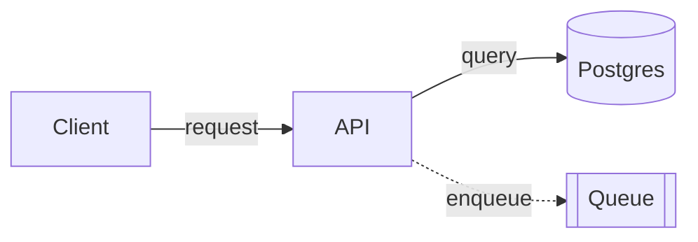

# Diagram tools

Each entry gives the use, the format, a core pattern, and pitfalls. Patterns are sketches. Check them against the pinned version before you use one.

## ASCII and Unicode text

- Tools: none. Write plain text in a fenced `text` block.
- Use for: diagrams in a terminal reply, code comment, commit message, or plain-text doc.
- Avoid for: more than about 12 nodes or many crossing edges. Use Mermaid.

```text
┌────────┐  request  ┌────────┐  query  ┌──────────┐
│ Client │ ────────▶ │  API   │ ──────▶ │ Postgres │
└────────┘           └───┬────┘         └──────────┘
                         │ enqueue
                         ▼
                    ┌─────────┐
                    │  Queue  │
                    └─────────┘
```

Pitfalls:

- Use one character set per diagram. Do not mix `+-|` boxes with `┌─┐` boxes.
- Emoji, CJK, and some arrows are double width. They break alignment. Use `▶ ▼ ◀ ▲` or `> v < ^`.
- Do not use tabs. Keep lines under 80 columns for terminals and diffs.
- Count columns before you finish. One space off breaks a box edge.

## Mermaid

- Repo: https://github.com/mermaid-js/mermaid. CLI: `@mermaid-js/mermaid-cli`, binary `mmdc`.
- Use for: flowcharts, sequence, state, class, ER, Gantt, and timeline diagrams in Markdown. GitHub, GitLab, and Obsidian render it inline.
- Avoid for: precise layout or a hand-drawn style. Use Excalidraw or SVG.

````markdown

````

```bash
npx -p @mermaid-js/mermaid-cli@<version> mmdc -i diagram.mmd -o diagram.svg
```

Pitfalls:

- Quote labels that contain punctuation: `a["Step (1): load"]`.
- Use `flowchart`, not the older `graph` keyword. It supports more shapes and features.
- `end` is reserved in flowcharts. Write `End` or quote it.
- `mmdc` runs Puppeteer and downloads Chromium on first use.
- Renderers lag the latest syntax. Check that the target platform supports a new diagram type.

## Excalidraw

- Repo: https://github.com/excalidraw/excalidraw. React: `@excalidraw/excalidraw`.
- Format: a `.excalidraw` JSON file. Open it at https://excalidraw.com or in the VS Code Excalidraw extension.
- Use for: an editable hand-drawn sketch, whiteboard, or architecture diagram that a human will change.
- Avoid for: diagrams that must render inline in Markdown. Use Mermaid.

```json
{
  "type": "excalidraw",
  "version": 2,
  "source": "https://excalidraw.com",
  "elements": [
    { "id": "api", "type": "rectangle", "x": 0, "y": 0, "width": 160, "height": 80,
      "roundness": { "type": 3 }, "boundElements": [{ "type": "text", "id": "api-label" }] },
    { "id": "api-label", "type": "text", "x": 50, "y": 28, "width": 60, "height": 25,
      "text": "API", "originalText": "API", "fontSize": 20, "containerId": "api",
      "textAlign": "center", "verticalAlign": "middle" },
    { "id": "to-db", "type": "arrow", "x": 160, "y": 40, "width": 120, "height": 0,
      "points": [[0, 0], [120, 0]] }
  ],
  "appState": { "viewBackgroundColor": "#ffffff" },
  "files": {}
}
```

Pitfalls:

- Excalidraw fills missing optional fields on load. Give each element a unique `id`, `type`, `x`, `y`, `width`, and `height`.
- Label a shape with a bound text element. Set `containerId` on the text and list it in the shape's `boundElements`.
- Arrow `points` are relative to the arrow's `x` and `y`. To attach an arrow, set `startBinding` and `endBinding`, and list the arrow in each shape's `boundElements`.
- The `label` shorthand only works in the `convertToExcalidrawElements` skeleton API. It is not valid in a saved file.
- To convert Mermaid, use `@excalidraw/mermaid-to-excalidraw`. It needs a browser DOM.
- Open the file to check it. Overlaps and clipped text are common in generated layouts.
